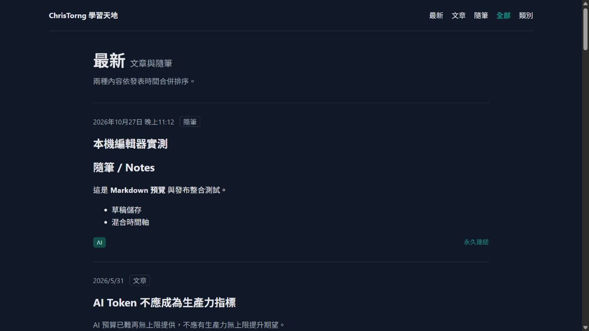

# 隨筆 / Notes 本機實測紀錄

測試日期：2026-10-27～2026-10-28（Asia/Taipei）。

## 結果

| 項目 | 實際結果 |
| --- | --- |
| npm 安裝／lockfile | 成功；npm audit 0 vulnerabilities |
| Wrangler | 4.153.0，Worker 於 `127.0.0.1:8787` 啟動；Static Assets + 本機 D1 |
| D1 migration | `0001_initial.sql` 成功；再次執行顯示 No migrations to apply |
| 語法與單元／回歸測試 | `npm run check`：11 / 11 通過 |
| Worker 端到端 | `npm run test:integration`：19 項檢查通過，建立／清除 106 筆隨筆 |
| Next.js 代理端到端 | `TEST_BASE_URL=http://localhost:3000`：同一組 19 項檢查通過 |
| 混合時間軸 | 完整靜態索引的 81 篇已發布文章 + 測試隨筆；所有分頁不遺漏、不重複、時間倒序 |
| PowerShell smoke test | 代理網址的建立、公開讀取、SSR、RSS、sitemap、改草稿及刪除全數通過 |
| Blog 型別檢查 | 隔離副本執行 `tsc --noEmit --tsBuildInfoFile .next/notes-check.tsbuildinfo`，exit 0 |
| 瀏覽器 | 內建瀏覽器實際登入、Markdown 預覽、草稿儲存／重開、公開發布、未儲存草稿重載回復、公開列表、混合時間軸及原 blog 首頁導覽成功 |
| 瀏覽器錯誤 | 混合時間軸檢查時 console error 清單為空 |
| 測試清理 | 已清除整合、smoke、瀏覽器所建立資料；本機公開隨筆數為 0 |

截圖是在清理瀏覽器測試隨筆前保存，因此包含「本機編輯器實測」；不是正式發布內容。

## 已驗證的行為

- 未授權管理請求、偽造 Email 標頭、跨來源寫入及未知標籤遭拒絕。
- 草稿不出現在公開 API、HTML、RSS、sitemap；改為草稿後再次隱藏。
- CRUD 實際讀寫 Wrangler 本機 D1。更新保留永久網址和原始發布時間。
- Markdown 禁用原始 HTML，危險連結不執行；SSR 有完整內容及合法 JSON-LD。
- HEAD、編輯器 CSS／JavaScript、公開與管理分頁、主題篩選正常；管理清單可超過 100 筆。
- Notes RSS 最多 100 筆；混合 RSS 最多 100 筆；XML 可解析，RSS 連結為完整網址。
- sitemap 包含超過 100 筆已發布資料；不只輸出第一頁。
- `/notes` 與 `/notes/` 均能經過 Next.js 代理；沒有將瀏覽器重新導向到 Worker 的 8787 埠。
- 完整文章索引失效時警示並改讀 RSS；兩者不可用時混合 RSS 回應 503。
- Access 驗證使用本機產生的 RSA 金鑰實測正確簽章，並拒絕錯誤簽章、issuer、audience、過期 Token 及不符的 Email。正式管理頁與 API 在未設定 Access 時拒絕存取。

## 原 blog 的既有問題與測試範圍

原 blog 位於 `D:\Projects\GitHub\ChrisTorng\christorng.github.io`。

直接執行該 working tree 時，Contentlayer 因既有未提交文章中的未知分類「個人」退出；另有 `data/blog/2027/20272010--The Next Global Crisis May Begin with an AI Decision.md` YAML 語法錯誤。未編輯、移動、刪除這些文章，也未處理無關的作者文件警告。

因此完整整合測試使用原 blog 提交 `8b076602599f0304aa0726d2ce1b901c1142247a` 的隔離副本 `.local/blog`，加入本次三個整合變更。這是實際 Next.js 15.5.12 + Contentlayer 的執行結果，沒有用假 HTML 或模擬 blog RSS 取代。隔離副本略過原 working tree 的未提交文章；原有開發依賴以 node_modules junction 重用。

原 blog 僅保留本次兩個已追蹤檔的本機修改及一個新增靜態索引路由，沒有 commit/push 原 blog。可重複安裝的相同變更已收錄於 `blog-notes/integration/`。

未執行正式 build：遵守原 blog AGENTS.md，不在 Next.js dev 運作時執行 build。新增靜態索引路由已在實際 Next.js dev 中回應，並通過完整 blog TypeScript 檢查；static export 正式建置仍需在停用 dev 後另行驗證。

## 待完成的外部項目

- 修正原 blog 未提交文章的分類與 YAML 後，才能直接在原 working tree 啟動；目前可用隔離副本預覽。
- 真實遠端 D1、Cloudflare Access 設定、JWKS／OTP／手機登入登出及正式 Route 尚未設定或測試。
- Kit RSS 擷取與寄送尚未測試。
- Edge Dev 未出現在可控制的瀏覽器清單，本次 UI 驗證使用內建瀏覽器。
- 主題定義仍為原 blog 的鏡像檔，未建立自動同步機制。

未部署 Worker、未修改 DNS／正式 Route、未執行遠端 migration、未發送電子郵件。
